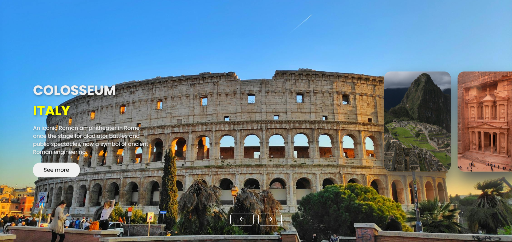

# 7 Wonders of the World 🌏✨

An interactive and visually engaging website showcasing the **Seven Wonders of the World**. Explore these remarkable landmarks through an immersive **image slider**, featuring stunning visuals, landmark names, and brief descriptions that bring each wonder closer to you.

Discover the beauty, history, and architectural brilliance of these extraordinary wonders!

---

## 🖼️ Preview  

  

---

## 🌐 Live Demo

The project is live and can be viewed here: [Wonders of the World](https://tonystark-19.github.io/Wonders-of-the-World/)

---

## 🚀 Features

| Feature | Description |
|:---|:---|
| **Interactive Image Slider** | Explore all seven wonders through a dynamic image slider featuring high-quality images, landmark names, and brief descriptions, with smooth JavaScript-powered transitions. |
| **Fully Responsive Design** | Enjoy a seamless browsing experience across all devices, including mobiles, tablets, and desktops. |

---

## 🛠️ Technologies Used

| Technology | Description |
|:---|:---|
| **HTML** | Structured the website's content and layout. |
| **CSS** | Styled the website with layouts, typography, and responsive design. |
| **JavaScript** | Implemented interactive functionality, including the image slider and navigation. |
| **Pexels** | Sourced high-quality images from [Pexels](https://www.pexels.com) for the website's visuals. |

---

## 🏆 Wonders Included

| Wonder | Description |
|:---|:---|
| **The Great Wall of China** | An ancient defensive structure stretching across northern China, built to protect Chinese territories. |
| **Petra** | A historic archaeological city in Jordan, famous for its rock-cut architecture and rose-red sandstone. |
| **Christ the Redeemer** | An iconic statue of Jesus Christ overlooking Rio de Janeiro, Brazil. |
| **Machu Picchu** | An ancient Incan citadel in Peru, nestled high in the Andes Mountains. |
| **Chichen Itza** | A remarkable Mayan archaeological site in Mexico, known for its iconic pyramid, El Castillo. |
| **Roman Colosseum** | An ancient Roman amphitheatre in Italy, famous for gladiatorial contests and public spectacles. |
| **Taj Mahal** | A magnificent white marble mausoleum in Agra, India, built by Emperor Shah Jahan in memory of Mumtaz Mahal. | 

---

## 🎖️ Credits  

- 📸 Images sourced from [Pexels](https://www.pexels.com).  
- 🖥️ Designed and developed by **Aditya Chandel**.  
